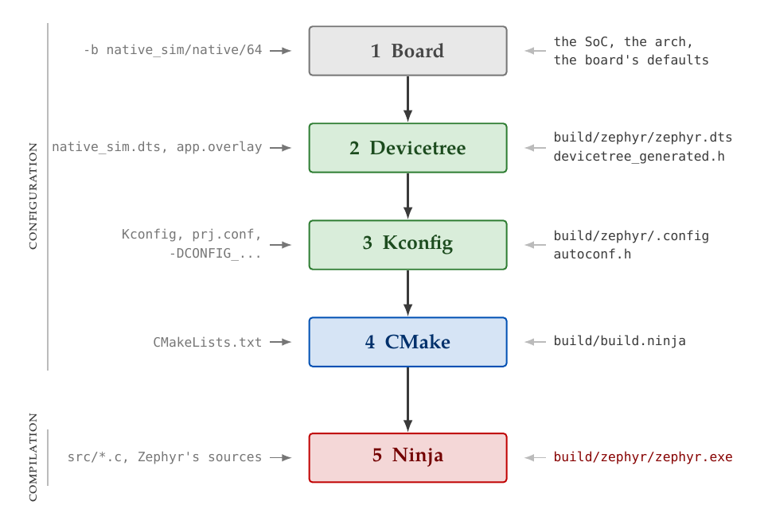

# Appendix B
## Zephyr, west and the Build
This appendix covers what Zephyr is, the board the course runs it on, the workspace it lives in, and
the build that turns an application into a program. By the end you should be able to explain every
file in the [`hello`](../examples/hello) and [`kconfig`](../examples/kconfig) examples, and every
line of output their builds print that matters.

---

## What Zephyr is
Zephyr is an open-source real-time operating system for microcontrollers, hosted by the Linux
Foundation and licensed under Apache 2.0. It runs on ARM Cortex-M and Cortex-A, RISC-V, x86,
Xtensa, ARC and more, and ships support for well over a thousand boards.

The word *operating system* is meant more literally than in "FreeRTOS". FreeRTOS gives you a
scheduler and a handful of kernel objects, and you bring everything else: the drivers, the logging,
the build. Zephyr ships all of it:

| Part | What it gives you |
|------|-------------------|
| **The kernel** | Threads, scheduling, interrupts, timers, and kernel objects for synchronization and communication. L03 and L04. |
| **The device driver model** | One API per kind of device (GPIO, I2C, sensor, flash, …), implemented by drivers for many chips. L02 and L05. |
| **Subsystems** | Logging, a shell, settings storage, file systems, networking, Bluetooth, USB, and more. This lecture and L06. |
| **The build system** | CMake, Kconfig and devicetree, which select and configure all of the above at compile time. This lecture and L02. |
| **Test tooling** | The ztest framework and the Twister test runner. L05. |

**Everything is decided at compile time.** A Zephyr image holds only the drivers, subsystems and
kernel features the application asked for, sized for the board it was built for. There is no
loading of drivers at run time and nothing to discover: the build has already worked out what
hardware exists and which code serves it. That is what makes Zephyr fit into a few kilobytes, and
it is also why most of what is hard about Zephyr is in the build. If you have met Linux's
`make menuconfig` or its `.dts` files, those are the same two ideas, Kconfig and devicetree, used
the same way.

Zephyr releases roughly three times a year, with a long-term support (LTS) release, maintained
with fixes for years, every few releases. Projects pin a release and move deliberately; so does
this course.

---

## native_sim
A *board*, in Zephyr, is what an application is built for: a processor, the peripherals around
it, and how they are wired. `native_sim` is a board that does not exist. It is Zephyr's **POSIX
architecture**: the kernel, drivers and application compiled together into an ordinary Linux
program, which runs on the host CPU.

```bash
west build -b native_sim/native/64 lectures/L01/examples/hello
./build/zephyr/zephyr.exe
```

Nothing is emulated at the instruction level, as QEMU would. Each Zephyr thread is backed by a
Linux thread, and the kernel lets exactly one of them run at a time, so Zephyr's scheduler is in
charge exactly as on a microcontroller. The hardware is what is simulated: a system timer, an
interrupt controller, and a set of peripherals with emulated backends, among them a GPIO
controller, an I2C bus, a flash chip and an EEPROM. L02 and L05 use those.

**Time on `native_sim` is simulated.** The system timer counts simulated microseconds, and the
simulator advances that clock only when every Zephyr thread is waiting for something. By default a
program slows its clock down to real time, so that a one-second sleep takes a second, which is
what you want when you watch it. Two command-line options change that:

| Option | Effect |
|--------|--------|
| `-no-rt` | Advance simulated time as fast as the host can. Ten simulated minutes take a moment. |
| `-stop_at=<seconds>` | Stop the program after that much simulated time. |

`./build/zephyr/zephyr.exe --help` lists all of them. Because time is simulated, a program's
behaviour does not depend on how busy the host is: it prints the same timestamps on every run, on
every machine. The exercises rely on that.

**The same property is `native_sim`'s biggest limitation.** Code runs in zero simulated time, so no
interrupt, not even the timer's, can arrive while a thread is running; only when it waits. A loop
such as `while (!flag) {}`, waiting for an interrupt to set `flag`, never ends, and because time
cannot advance, nothing else runs either. On a microcontroller that loop is merely wasteful. L03
shows it on purpose.

A few kernel features are also missing on `native_sim`: memory protection between threads
(userspace), and the stack overflow checks, since each thread really runs on its Linux thread's
stack. The Zephyr documentation lists them under *Native simulator: Important limitations*.

---

## The west workspace
Zephyr is not one repository. The kernel and core live in `zephyrproject-rtos/zephyr`, and the
vendor HALs, cryptography libraries, file systems and other *modules* each live in repositories
of their own, about eighty in all. **west** is Zephyr's tool for managing that: a multi-repository
manager in the spirit of Git submodules or Google's `repo`, plus a set of commands for building,
flashing and testing.

### Workspaces and manifests
A **west workspace** is a directory with a `.west/config` file in it. The config names a
**manifest**, a `west.yml` file listing the Git repositories (*projects*) that belong to the
workspace, where each one goes, and which revision of each one to check out.

This course's repository is its own workspace. `make setup` writes a `.west/config` that points at
the repository's [`west.yml`](../../../west.yml):

```yaml
manifest:
  remotes:
    - name: zephyrproject-rtos
      url-base: https://github.com/zephyrproject-rtos

  projects:
    - name: zephyr
      remote: zephyrproject-rtos
      revision: v4.4.2
      path: deps/zephyr
      clone-depth: 1
      west-commands: scripts/west-commands.yml

  self:
    path: .
```

Line by line:
* **`remotes`** give a name to a base URL. A project's repository URL is its remote's `url-base`
  followed by the project's name: `https://github.com/zephyrproject-rtos/zephyr`.
* **`revision: v4.4.2`** pins Zephyr to a release tag. It could as well be a branch or a commit
  hash, and in a product it should be a tag or a hash, so that the same manifest checks out the
  same code a year later.
* **`path: deps/zephyr`** is where the project is checked out, relative to the workspace.
* **`clone-depth: 1`** fetches only the pinned commit, not Zephyr's decade of history, which makes
  the first `west update` much faster, at the cost of `git log` showing one commit.
* **`west-commands`** tells west that Zephyr provides extra commands, `west build` and
  `west twister` among them. Without that line, west knows only its built-in commands.
* **`self: path: .`** says that the manifest repository is the workspace directory itself.

What the manifest does **not** do is import Zephyr's own `west.yml`, which lists all of Zephyr's
modules. `native_sim` needs none of them, and together they are several gigabytes. A product
built for a real microcontroller would import the few it needs, such as the vendor's HAL, by name.

### The commands
West's own commands manage the workspace:

```bash
west update                  # Check out every project at the revision the manifest pins.
west list                    # Show every project, its path and its revision.
west manifest --resolve      # Show the whole manifest, with imports expanded.
west config build.board      # Read a configuration value from .west/config.
```

`west list` in this workspace:

```text
manifest     .                            HEAD                                     N/A
zephyr       deps/zephyr                  v4.4.2                                   https://github.com/zephyrproject-rtos/zephyr
```

**Moving to another Zephyr release** is two steps: change `revision` in `west.yml`, and run
`west update`. West never updates a project on its own; `git pull` in the course repository
changes the manifest, and `west update` is what makes the workspace match it.

The extension commands that Zephyr adds are the ones used every day: `west build`, and, in L05,
`west twister`. On real hardware there would also be `west flash` and `west debug`.

---

## Anatomy of an application
A Zephyr application is a directory with at least three files:

```text
hello/
    CMakeLists.txt      How to build it.
    prj.conf            How to configure Zephyr for it.
    src/main.c          The code.
```

### CMakeLists.txt

```cmake
cmake_minimum_required(VERSION 3.20.0)
find_package(Zephyr REQUIRED HINTS $ENV{ZEPHYR_BASE})
project(hello)

target_sources(app PRIVATE src/main.c)
```

**`find_package(Zephyr)` is where Zephyr's build system takes over.** It finds Zephyr through
`ZEPHYR_BASE`, which `env.sh` sets, and then does most of the work described in *The build* below:
it reads the board, processes the devicetree, runs Kconfig, and sets up the whole of Zephyr as a
set of CMake libraries. It also creates a library target named **`app`**, which is where the
application's own sources go. `project()` must come after it, because Zephyr selects the compiler
before CMake's `project()` looks for one.

### prj.conf
A list of Kconfig settings, one per line, applied on top of the board's defaults:

```text
CONFIG_LOG=y
```

The file must exist, even if it is empty. An application without one fails to configure with
`No prj.conf file(s) was found`.

### src/main.c
`main()` is called by the kernel after it has initialized itself and every driver, in a thread
called `main`. Returning from it ends that thread, **not the program**: the kernel keeps running,
along with every other thread, and if nothing else has work to do, the idle thread runs forever. On
`native_sim` that is why a program whose `main()` has returned keeps running until `Ctrl+C` or
`-stop_at`.

### Optional files
Applications grow more files as they need them. Those you will meet in the course:

| File | What it is | Lecture |
|------|------------|---------|
| `Kconfig` | Configuration options of the application's own. | This one |
| `*.conf` | Extra Kconfig settings, merged when asked for with `-DEXTRA_CONF_FILE`. | This one |
| `app.overlay` | Changes to the board's devicetree for this application. | L02 |
| `dts/bindings/` | Devicetree bindings of the application's own. | L02 |
| `boards/` | Kconfig settings and overlays that apply to one board only. | L02 |
| `sample.yaml`, `testcase.yaml` | How Twister builds, runs and checks the application. | L05 |

---

## The build
### west build

```bash
west build -b native_sim/native/64 lectures/L01/examples/hello
```

`west build` is a wrapper around CMake and Ninja. It configures the application for the board given
with `-b`, into a build directory, `build/` unless `-d` says otherwise, and then builds it. The
options you will use most:

| Option | Effect |
|--------|--------|
| `-b <board>` | The board to build for. The course sets `native_sim/native/64` as the workspace default, so it may be left out. |
| `-d <dir>` | The build directory. Defaults to `build`. |
| `-p` | *Pristine*: delete the build directory first. By default (`-p auto`) west does so only when the application directory has changed. |
| `-t <target>` | Build a particular target, such as `run` or `menuconfig`. |
| `-- <args>` | Pass the rest on to CMake, e.g. `-- -DEXTRA_CONF_FILE=shout.conf`. |

A build directory remembers its board and application, so a second build of the same application
needs no arguments, and `west build -t run` from the repository root runs what `build/` holds.

### What happens when
A Zephyr build has two phases, and the first is the one that is different.

**Configuration**, which CMake runs, happens once per build directory, and again when an input
changes. In order:
1. **The board** is found, and with it the processor architecture, the SoC, and the board's
   default Kconfig settings and devicetree.
2. **Devicetree.** The board's devicetree and any overlays are combined into one tree, checked
   against their bindings, and turned into a C header of macros.
3. **Kconfig.** Every Kconfig option in Zephyr and the application is resolved, from its defaults,
   the board's settings, `prj.conf` and the rest, into one final configuration. Kconfig runs after
   devicetree because options may depend on it: once GPIO is enabled at all, the driver for a GPIO
   controller is enabled by default exactly when the devicetree has an enabled node for it
   (`depends on DT_HAS_ZEPHYR_GPIO_EMUL_ENABLED`, for `native_sim`'s).
4. **CMake** generates the build: which of Zephyr's source files to compile, decided by the
   Kconfig options, with which flags.

**Compilation**, which Ninja runs, then builds the libraries Zephyr is made of and links them with
the application into one image. On `native_sim` that image is a Linux executable.

The whole of it, in order:



The order explains most of Zephyr's error messages. A Kconfig error aborts configuration before a
line of C is compiled. A devicetree error aborts it even earlier. And a C file cannot change which
drivers are built, because by the time it is compiled, that has long been decided.

### The build directory
Among the thousands of files in `build/`, a few are worth knowing by name:

| File | What it holds |
|------|---------------|
| `build/zephyr/zephyr.exe` | The program, on `native_sim`. On a microcontroller the image would be `zephyr.elf`, `zephyr.bin` and `zephyr.hex`; `native_sim` writes a `zephyr.elf` too. |
| `build/zephyr/.config` | The final Kconfig configuration: every option and its value. |
| `build/zephyr/include/generated/zephyr/autoconf.h` | The same configuration as C macros, included into every source file. |
| `build/zephyr/zephyr.dts` | The final devicetree, overlays applied. L02. |
| `build/zephyr/include/generated/zephyr/devicetree_generated.h` | The devicetree as C macros. L02. |
| `build/zephyr/zephyr.map` | The linker map: where every symbol went. |
| `build/compile_commands.json` | Every compiler command line, for editors. |

### Running
On `native_sim`, the program is run either by the build or directly:

```bash
west build -t run                             # Run build/zephyr/zephyr.exe.
./build/zephyr/zephyr.exe -stop_at=3 -no-rt   # Run it with options.
```

---

## Kconfig
Zephyr has thousands of configuration options. Kconfig, the configuration language from the Linux
kernel, is how they are declared, how their dependencies are enforced, and how an application sets
them.

### Declaring options
An option is a *symbol* with a type, a prompt, a default, and optionally dependencies:

```text
config LOG
	bool "Logging"
	select PRINTK if USERSPACE
	help
	  Global switch for the logger, when turned off log calls will not be
	  compiled in.

if LOG

config LOG_DEFAULT_LEVEL
	int "Default log level"
	default 3
	range 0 4

endif # LOG
```

(Both are Zephyr's own, from `subsys/logging/Kconfig` and `Kconfig.filtering`, shortened.)

| Keyword | Meaning |
|---------|---------|
| `bool`, `int`, `hex`, `string` | The type, followed by the prompt shown in menuconfig. A symbol with no prompt cannot be set by the user; only defaults and `select` set it. |
| `default` | The value when nothing sets it. Several `default ... if ...` lines may follow each other; the first whose condition holds applies. |
| `depends on` | The symbol does not exist, and is `n`, unless the condition holds. `if LOG` ... `endif` adds `depends on LOG` to every symbol between them. |
| `select` | Forces another bool symbol to `y` whenever this one is `y`, dependencies or not. |
| `range` | The allowed values of an `int` or `hex`. |
| `menu`, `choice` | Group symbols in menuconfig; a `choice` allows exactly one of its bool symbols. |

### Where a value comes from
An option's final value is the last one assigned, from these sources in this order:
1. The **default** in the option's declaration.
2. The **board's defaults**, from the board's `_defconfig` file. For this course's board, that is
   `deps/zephyr/boards/native/native_sim/native_sim_64_defconfig`.
3. **`prj.conf`**, and any board-specific `.conf` file in the application's `boards/` directory.
4. **Extra configuration files**, given with `-DEXTRA_CONF_FILE=<file>`.
5. **The command line**: `-DCONFIG_LOG_DEFAULT_LEVEL=2` after `--` on the `west build` line.

Then Kconfig checks the result. Every assignment is only a *request*: an option whose dependencies
do not hold stays `n`, and an `int` outside its range falls back on its default. **Zephyr treats
that as an error**, because a request that silently did not take is how configurations rot. With
`CONFIG_SHELL_LOG_BACKEND=y` but no shell:

```text
warning: SHELL_LOG_BACKEND (defined at subsys/shell/Kconfig:278) was assigned the value 'y' but got
the value 'n'. Check these unsatisfied dependencies: SHELL (=n). ...

error: Aborting due to Kconfig warnings
```

The message names the dependency that failed. The fix is to enable it too, or to find out why it
cannot be.

### Reading the result
After a build, `build/zephyr/.config` holds every symbol's value, and grep is the fastest way to
answer *what did the build actually use?*:

```bash
grep -E "CONFIG_LOG_MODE|CONFIG_SYS_CLOCK_TICKS_PER_SEC" build/zephyr/.config
```

```text
CONFIG_SYS_CLOCK_TICKS_PER_SEC=100
CONFIG_LOG_MODE_IMMEDIATE=y
```

For browsing, `west build -t menuconfig` opens the same configuration in the terminal, and
`west build -t guiconfig` in a window, if Ubuntu's `python3-tk` package is installed. `/` searches,
and `?` on a symbol shows its definition,
dependencies and what selects it, which is the fastest way to find out *why* an option has the
value it has. **Changes made in menuconfig live only in the build directory**: they are lost with
the next pristine build. Anything that should last belongs in `prj.conf`.

### Using options from C
Every option that is set becomes a macro in `autoconf.h`, which the build includes into every
source file: `CONFIG_LOG_DEFAULT_LEVEL` is `3`, `CONFIG_BOARD_TARGET` is
`"native_sim/native/64"`, and a bool that is `y` is `1`. **A bool that is `n` is not defined at
all.** There are two ways to test one:

```c
#ifdef CONFIG_APP_SHOUT
	shout(greeting, loud, sizeof(loud));
#endif

if (IS_ENABLED(CONFIG_APP_SHOUT)) {
	shout(greeting, loud, sizeof(loud));
}
```

Prefer **`IS_ENABLED()`**. It expands to `1` or `0`, so the code inside is compiled and type-checked
in every configuration and removed by the compiler in the ones where it cannot run. Code behind
`#ifdef` is not even parsed when the option is off, so it breaks unnoticed. Keep `#ifdef` for what
cannot compile at all when the option is off, such as a reference to a struct member that exists
only with the option.

Both forms share one trap. `IS_ENABLED(CONFIG_APP_SHOUTT)`, misspelled, compiles without a warning
and is `0`, because an undefined macro is simply an option that is off. Kconfig catches a
misspelled option in `prj.conf`; nothing catches one in C.

### Using options from CMake
Kconfig has run by the time `find_package(Zephyr)` returns, so every option is a CMake variable too,
and CMake can decide what to compile:

```cmake
target_sources_ifdef(CONFIG_APP_SHOUT app PRIVATE src/shout.c)
```

That is how all of Zephyr is built: nearly every driver and subsystem is a list of
`*_sources_ifdef(CONFIG_...)` lines.

### Options of your own
An application with a file named `Kconfig` gets options of its own. That file **replaces** Zephyr's
top-level Kconfig file for the build, so it must bring Zephyr's back in at the end:

```text
menu "Application"

config APP_REPEAT
	int "How many times to print the greeting"
	range 1 10
	default 3

endmenu

source "Kconfig.zephyr"
```

Prefix the options with `APP_`, or with the application's name, so that they cannot collide with
Zephyr's. They then behave exactly like Zephyr's own: they appear in menuconfig, are set from
`prj.conf`, and reach C and CMake as `CONFIG_APP_REPEAT`.

---

## printk and logging
### printk
`printk()` prints to the console, with `printf()`-style formatting from Zephyr's own small
formatter. It writes synchronously, from any context, and is on by default. It is the right tool
for a quick look, and the wrong one for anything that ships.

### The logging subsystem
Logging is enabled with `CONFIG_LOG=y`. Each source file belongs to a **log module**, registered
once, with a name and a level:

```c
#include <zephyr/logging/log.h>

LOG_MODULE_REGISTER(monitor, LOG_LEVEL_INF);

LOG_ERR("Temperature %d C is critical", celsius);
LOG_WRN("Temperature %d C is high", celsius);
LOG_INF("Temperature %d C", celsius);
LOG_DBG("Raw sample 0x%04x", raw);
```

Every message is printed with a timestamp, its level and its module, and in color on a terminal:

```text
[00:00:01.530,000] <wrn> monitor: Temperature 33 C is high
```

Other files of the same module use `LOG_MODULE_DECLARE(monitor, LOG_LEVEL_INF)` instead of
registering it again. `LOG_HEXDUMP_INF(data, length, "label")` prints a buffer.

### Levels
The levels are numbered: `LOG_LEVEL_NONE` is 0, `ERR` 1, `WRN` 2, `INF` 3 and `DBG` 4. **A module's
level is a compile-time filter**: a message above it is not merely suppressed, it is not compiled
into the image at all, format string included. That is why debug messages can be left in the code
for free, and why turning them on needs a rebuild.

`LOG_MODULE_REGISTER(monitor)`, with no level, uses `CONFIG_LOG_DEFAULT_LEVEL`, which is 3 unless
something sets it. Zephyr's own modules each have a Kconfig option for their level instead, such as
`CONFIG_I2C_LOG_LEVEL`, and an application can give its modules one the same way, with a template
from Zephyr's logging Kconfig:

```text
module = MONITOR
module-str = monitor
source "subsys/logging/Kconfig.template.log_config"
```

That declares a choice of levels, set in `prj.conf` with a line such as
`CONFIG_MONITOR_LOG_LEVEL_DBG=y`, and the resulting number as `CONFIG_MONITOR_LOG_LEVEL`. The module
is registered with `LOG_MODULE_REGISTER(monitor, CONFIG_MONITOR_LOG_LEVEL)`.

### Deferred and immediate
There are two ways a message can reach the console, and the choice matters on a microcontroller:
* **Deferred** logging, the default on real hardware, only copies the message's arguments into a
  buffer; a low-priority log thread formats and prints it later. Logging from an interrupt handler
  then costs microseconds, not the milliseconds a UART takes. The price is that a log message and a
  `printk()` right after it may appear in the opposite order, and that messages still in the buffer
  are lost if the system crashes.
* **Immediate** logging formats and prints in the caller, like `printk()`.

**`native_sim` logs in immediate mode by default** (`CONFIG_LOG_MODE_IMMEDIATE`), because printing
on a host costs nothing that matters and ordered output is easier to read. Keep in mind that the
same application on a board will be deferred unless told otherwise.

---

## Time, briefly
L03 covers time properly. Two things are needed before then.

**Delays are written in milliseconds and kept in ticks.** `k_msleep(500)` and `k_sleep(K_MSEC(500))`
are the same call. The kernel converts the duration to *ticks* of its system clock, of which
`native_sim` has `CONFIG_SYS_CLOCK_TICKS_PER_SEC=100`, one every 10 ms. `k_uptime_get()` returns the
milliseconds since boot.

**A sleep lasts at least as long as asked, and usually a little longer.** A thread that calls
`k_msleep(500)` at some moment within a tick cannot know how much of that tick is left, so the
kernel waits the 50 ticks the duration needs, plus the rest of the current one. That is why the
[`hello`](../examples/hello) example wakes at 510 ms and 1020 ms, not at 500 and 1000. On
`native_sim` the numbers are the same on every run; on a board they would be the same too, which
is the point of a tick-based kernel.

---

## Summary
* Zephyr is a kernel, a driver model, subsystems, and a build that selects and configures all of
  them at compile time.
* `native_sim` builds Zephyr into a Linux program with simulated time: deterministic and fast, but
  a thread that never waits stops the world.
* A west workspace is a manifest and the repositories it pins. `west update` makes the workspace
  match the manifest.
* An application is `CMakeLists.txt`, `prj.conf` and sources. `find_package(Zephyr)` is where the
  build takes over.
* The build configures in order: board, devicetree, Kconfig, CMake. Then it compiles.
* A Kconfig value is the last one assigned, from the defaults through `prj.conf` to the command
  line, and an assignment that does not take aborts the build. `build/zephyr/.config` shows the
  result.
* Use `IS_ENABLED()` in C, and `*_ifdef()` in CMake. A misspelled `CONFIG_` macro in C is off,
  silently.
* Log through log modules. A module's level decides at compile time which messages exist.

---
