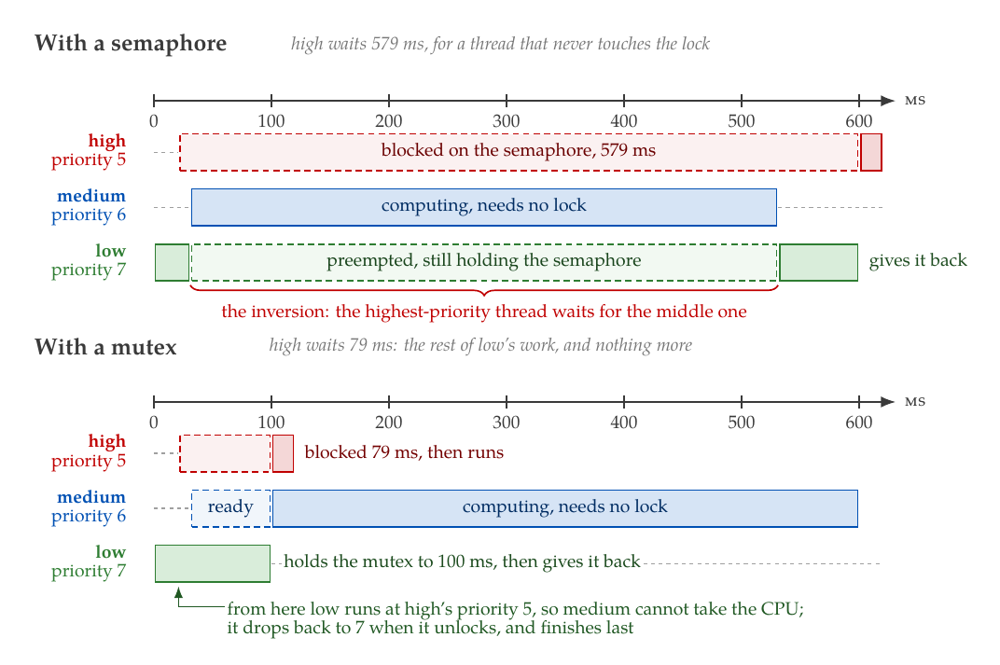

# Appendix A
## Kernel Objects: Synchronization, Data and Memory
L03 was about threads on their own: who runs, when, and for how long. This appendix is about
threads together: how they wait for each other, protect what they share, hand each other data, and
get memory without `malloc()`. By the end you should be able to explain every line the
[`msgq`](../examples/msgq) and [`priority_inversion`](../examples/priority_inversion) examples print.
[Appendix B](./b_zbus_and_smf.md) builds on it with two ways of structuring an application.

---

## Waiting, and how long for
Every kernel call that can block takes a **timeout** as its last argument, of type `k_timeout_t`:

| Timeout | Meaning |
|---------|---------|
| `K_NO_WAIT` | Do not wait. If the call cannot succeed at once, it fails at once. |
| `K_MSEC(n)`, `K_SECONDS(n)`, … | Wait at most that long, then fail. |
| `K_FOREVER` | Wait for as long as it takes. |

A call that fails tells you why through its return value, and the two failures mean different
things. `-EBUSY` (or `-ENOMSG`, or `-ENOMEM`, depending on the object) says *it was not possible
right now, and you asked not to wait*. `-EAGAIN` says *you waited as long as you allowed, and it
still did not become possible*. Both are ordinary results, not errors to ignore: a thread that takes
a lock with a timeout and does not check whether it got it is a data race waiting to happen.

**An interrupt handler must always pass `K_NO_WAIT`**, because an ISR has no thread to put to
sleep. The API documentation marks every function an ISR may call with *isr-ok*, and the ones that
take a timeout add *timeout must be set to `K_NO_WAIT` if called from ISR*.

**A thread waiting on an object waits in a queue ordered by priority.** When the object becomes
available, the highest-priority waiter gets it, and among waiters of equal priority, the one that
has waited longest. A thread that becomes ready this way preempts the current thread if it has a
higher priority, exactly as a thread waking from `k_sleep()` would.

---

## Semaphores
A `k_sem` is a counter with a limit:

```c
K_SEM_DEFINE(data_ready, 0, 1);   /* Initial count 0, limit 1. */

/* In an interrupt handler, or another thread: */
k_sem_give(&data_ready);

/* In the thread that processes the data: */
if (k_sem_take(&data_ready, K_MSEC(100)) == 0) {
	process();
}
```

`k_sem_take()` decrements the count if it is above zero, and otherwise waits. It returns `0` when it
got the semaphore, `-EBUSY` when it did not and was told not to wait, and `-EAGAIN` when its timeout
expired. `k_sem_give()` wakes the first waiter if there is one, and otherwise increments the count,
**but never above the limit**: three gives to a semaphore with limit 1 and no waiters leave its count
at 1. It never blocks, and may be called from an ISR.

Semaphores are the tool for **signalling and counting**: *data is ready*, *an event happened*,
*there are N free buffers*. A semaphore with limit 1 signals that something happened at least once
since the last take, not how many times.

**A semaphore has no owner.** Any thread may give it, whether or not that thread took it, and the
kernel does not know or care which thread "holds" it. That is exactly what makes a semaphore right
for signalling, and wrong as a lock, for a reason the next two sections are about.

---

## Mutexes
A `k_mutex` is a lock with an owner:

```c
K_MUTEX_DEFINE(bus_lock);

k_mutex_lock(&bus_lock, K_FOREVER);
/* ... use the bus: the critical section ... */
k_mutex_unlock(&bus_lock);
```

Three things follow from having an owner:
* **Only the owner may unlock it.** `k_mutex_unlock()` from another thread returns `-EPERM`, and on a
  mutex that is not locked at all, `-EINVAL`.
* **It is recursive.** The owner may lock it again without blocking: the kernel counts the locks,
  and the mutex is released when the owner has unlocked it as many times as it locked it. A helper
  that locks the bus can therefore be called from code that already holds the bus lock.
* **It cannot be used in an ISR.** An interrupt handler is not a thread, so it cannot own anything.
  An ISR that needs to share data with a thread uses a spinlock, `irq_lock()`, or better, hands
  the data over through a message queue.

And one thing that matters more than all three: **priority inheritance**.

### Priority inversion
Three threads share one CPU: `high`, `medium` and `low`. `low` locks a resource that `high` also
needs. Then:
1. `low` takes the lock and starts its critical section.
2. `high` becomes ready, preempts `low`, tries to take the lock, and blocks.
3. `medium` becomes ready. It needs no lock at all. It has a higher priority than `low`, so it
   preempts `low`, and runs for as long as it has work.
4. Only when `medium` is done does `low` get the CPU back, finish its critical section, and release
   the lock. Only then can `high` run.

`high`, the most important thread in the system, has waited for `medium`, a less important thread
it has nothing to do with. That is **priority inversion**, and what makes it dangerous is step 3:
`high`'s wait is no longer bounded by `low`'s critical section, which the designer knows and keeps
short, but by the run time of every thread with a priority between the two, which nobody bounded.
The Mars Pathfinder lander reset itself repeatedly in 1997 for exactly this reason.

The [`priority_inversion`](../examples/priority_inversion) example produces it on purpose. With a
semaphore as the lock, `high waited 579 ms`: 69 ms of `low`'s remaining work plus all 500 ms of
`medium`'s.

### Priority inheritance
When a thread blocks on a locked `k_mutex`, the kernel raises the owner's priority to the waiter's,
if the waiter's is higher. The owner now runs at `high`'s priority, so `medium` can no longer
preempt it; it finishes its critical section and unlocks, and at the unlock the kernel restores the
priority it had when it locked the mutex. With a mutex in the example, `high waited 79 ms`, just
the rest of `low`'s critical section, and the trace shows `low (priority 5) gives the mutex back`:
`low` was running at `high`'s priority.

Both runs of the example, on one scale:



If the waiting thread gives up because its timeout expires, the kernel lowers the owner's priority
again, to that of the highest-priority thread still waiting, or back to its own.

What priority inheritance does **not** do:
* **It does not remove the wait.** `high` still waits for `low`'s critical section. Inheritance
  bounds the wait by the critical section's length; keeping that short is still the designer's job.
* **It does not cope well with several mutexes.** The owner's original priority is saved in each
  mutex when it is locked. If a thread holds several mutexes and releases them in a different order
  than its priority was raised, its priority can be restored wrongly. Zephyr's documentation
  recommends that a thread lock only one mutex at a time when several are shared between threads of
  different priorities.
* **It does not prevent deadlock.** Two threads that lock two mutexes in opposite orders still wait
  for each other forever. Always take nested locks in the same order.

`CONFIG_PRIORITY_CEILING` caps how high inheritance may raise a priority. Its default, -128, allows
any.

### On `native_sim`: making a thread use CPU time
Priority inversion needs a thread that *computes*: holds the CPU without blocking. On `native_sim`,
code runs in zero simulated time, so a loop of instructions takes no time at all, and `medium` would
finish before anything could preempt it. The examples and exercises use **`k_busy_wait()`**
instead, which advances simulated time while keeping the CPU, and during which interrupts are still
handled: a thread that becomes ready meanwhile preempts the busy thread, as it would on a
microcontroller. The examples busy-wait one millisecond at a time, because a busy wait ends at a
fixed deadline even if the thread was preempted in between: one call of `k_busy_wait(100000)`
would count time spent preempted as work done.

---

## Events
A `k_event` is a set of 32 bits that threads can wait on:

```c
K_EVENT_DEFINE(heater_events);

#define EVENT_START BIT(0)
#define EVENT_FAULT BIT(4)

/* From anywhere, including an ISR: */
k_event_post(&heater_events, EVENT_FAULT);

/* In the thread: wait for any of the events, and clear the ones returned. */
uint32_t events = k_event_wait_safe(&heater_events, EVENT_START | EVENT_FAULT,
				   false, K_FOREVER);
```

`k_event_post()` sets bits, `k_event_set()` replaces them all, and `k_event_clear()` clears some.
`k_event_wait()` returns as soon as any of the requested bits is set, and `k_event_wait_all()`
when all of them are. Both return the matching bits, or 0 on a timeout. The `_safe` versions also
clear the bits they return in the same step, so that an event posted between the wait returning and
a separate `k_event_clear()` cannot be lost. Events need
`CONFIG_EVENTS=y`.

**An event object is a set of bits, not a queue.** Posting a bit that is already set does nothing,
so three posts of `EVENT_START` before the thread runs are one `EVENT_START`, and the order in which
different bits were posted is lost. The [`smf`](../examples/smf) example shows it happening. Use
events for *which conditions are true now*, and a message queue when the count or the order matters.

---

## Message queues
A `k_msgq` passes fixed-size messages between threads, by copying them:

```c
struct sample {
	uint32_t seq;
	int64_t timestamp_ms;
};

/* Room for four samples, allocated statically.
 * The last argument is the alignment. */
K_MSGQ_DEFINE(samples, sizeof(struct sample), 4, alignof(struct sample));

/* The producer: */
struct sample s = {.seq = 1, .timestamp_ms = k_uptime_get()};
int err = k_msgq_put(&samples, &s, K_NO_WAIT);

/* The consumer: */
struct sample s;
k_msgq_get(&samples, &s, K_FOREVER);
```

`k_msgq_put()` copies the message into the queue, and `k_msgq_get()` copies it out, first in, first
out. Both return `0` on success, `-ENOMSG` when they could not and were told not to wait, and
`-EAGAIN` when their timeout expired. Put may be called from an ISR with `K_NO_WAIT`, which makes a
message queue the standard way to hand data from an interrupt handler to a thread.

Because messages are copied, **the sender's variable can go out of scope as soon as the put
returns**, and the queue's memory is the only memory involved: `max_msgs × msg_size` bytes,
allocated by `K_MSGQ_DEFINE()` at link time. Keep messages small, a few tens of bytes. Larger data
travels better as a pointer in a small message, or through a FIFO.

When a thread is already waiting in `k_msgq_get()`, a put copies the message straight into that
thread and makes it ready, and if it has the higher priority, it runs before the put even returns.
That is why the [`msgq`](../examples/msgq) example prints `consumed #1` before `produced #1`, and a
queue that is `0/4` right after the first put.

Other calls: `k_msgq_peek()` reads the next message without removing it, `k_msgq_put_front()` puts
a message at the head, `k_msgq_purge()` discards everything and wakes blocked senders with
`-ENOMSG`, and `k_msgq_num_used_get()` and `k_msgq_num_free_get()` report how full the queue is.

### When the queue is full
A full queue is a design decision, not an accident, and the producer's timeout is where it is made:
* **`K_FOREVER`: slow the producer down.** Nothing is lost, and the producer runs at the consumer's
  pace. Right when every message matters and the producer can wait, such as commands.
* **`K_NO_WAIT`: drop the new message.** The producer keeps its rate, and must decide what to do
  with the failure: count it, report it. The only option in an ISR.
* **Make room: drop the oldest.** With one producer, `k_msgq_get()` with `K_NO_WAIT` and a second
  put keep the newest data, which is usually what sensor data wants.
* **A timeout: wait a little.** Absorbs short bursts without letting a stuck consumer stop the
  producer.

The example's two phases show the first two: with `K_NO_WAIT` samples #8, #10 and #12 are dropped,
and with `K_FOREVER` nothing is, but from #21 on every put blocks for 150 ms.

---

## FIFOs and LIFOs
A `k_fifo` passes data items **by reference**:

```c
struct packet {
	void *reserved;      /* The first word belongs to the kernel. */
	size_t length;
	uint8_t data[128];
};

K_FIFO_DEFINE(rx_packets);

/* Put never blocks and may be called from an ISR; get returns NULL on timeout. */
k_fifo_put(&rx_packets, packet);
struct packet *p = k_fifo_get(&rx_packets, K_FOREVER);
```

Nothing is copied: the FIFO links the items together through their **first word**, which the kernel
overwrites, so every item type starts with a pointer-sized member the code never touches. The item
must stay valid until it is taken out, so it cannot be a local variable of the sender; it comes from
a static pool, a memory slab or a heap. A FIFO has no size limit, because the items bring their own
memory, and it never blocks on put. A `k_lifo` is the same, last in, first out.

Use a message queue for small values and a FIFO for large buffers that already live somewhere.

---

## Waiting for several things: `k_poll()`
A thread that must react to a command *or* new data cannot block in `k_msgq_get()` on one of them.
`k_poll()` waits for any of several conditions:

```c
struct k_poll_event events[] = {
	K_POLL_EVENT_INITIALIZER(K_POLL_TYPE_SEM_AVAILABLE,
				 K_POLL_MODE_NOTIFY_ONLY, &data_ready),
	K_POLL_EVENT_INITIALIZER(K_POLL_TYPE_MSGQ_DATA_AVAILABLE,
				 K_POLL_MODE_NOTIFY_ONLY, &commands),
};

while (true) {
	k_poll(events, ARRAY_SIZE(events), K_FOREVER);

	if (events[0].state == K_POLL_STATE_SEM_AVAILABLE) {
		k_sem_take(&data_ready, K_NO_WAIT);
		process_data();
	}
	if (events[1].state == K_POLL_STATE_MSGQ_DATA_AVAILABLE) {
		k_msgq_get(&commands, &command, K_NO_WAIT);
		handle(&command);
	}
	events[0].state = K_POLL_STATE_NOT_READY;
	events[1].state = K_POLL_STATE_NOT_READY;
}
```

Three rules, all easy to miss:
* **`k_poll()` does not take anything.** It only reports that the semaphore was available: the
  thread still takes it, with `K_NO_WAIT`, and must handle failing to, since a thread blocked in
  `k_sem_take()` has precedence over a polling one.
* **Check every event's `state`**, since several may be ready at once.
* **Reset every `state` to `K_POLL_STATE_NOT_READY`** before polling again.

Polling needs `CONFIG_POLL=y`. Besides semaphores and message queues, it can wait on FIFOs and on a
`k_poll_signal`, a lightweight flag raised with `k_poll_signal_raise()`.

---

## Choosing
| You need to | Use |
|-------------|-----|
| Protect data shared between threads | `k_mutex` |
| Protect data shared with an ISR | A spinlock or `irq_lock()`, held briefly; or pass the data, below |
| Signal that something happened, or count available resources | `k_sem` |
| Wait for any or all of several conditions | `k_event`, or `k_poll()` |
| Pass small values, copied, from a thread or an ISR | `k_msgq` |
| Pass large buffers by reference | `k_fifo` |
| Decouple the parts of an application | zbus, in Appendix B |

**Never use a semaphore as a lock between threads of different priorities.** It works, until a
thread of medium priority arrives.

---

## Memory without malloc
Every object in this appendix was defined with a `K_..._DEFINE()` macro, at file scope, and so were
the threads and their stacks. That is not a coincidence: **Zephyr applications allocate
statically**, so that the linker knows all the memory the system will ever use, and the question
*can we run out of memory at run time?* is answered before the firmware ships. For the same
reason, **Zephyr has no
system heap by default**: `CONFIG_HEAP_MEM_POOL_SIZE` is 0, and a call to `k_malloc()` does not even
link:

```text
undefined reference to `k_malloc'
```

When an application does need memory at run time, Zephyr offers two allocators, each backed by a
static region of its own, so that one part of the system running out cannot starve another.

### Memory slabs
A `k_mem_slab` hands out fixed-size blocks:

```c
/* Four blocks of 64 bytes, aligned to 8. */
K_MEM_SLAB_DEFINE(packet_slab, 64, 4, 8);

void *block;

if (k_mem_slab_alloc(&packet_slab, &block, K_NO_WAIT) == 0) {
	/* ... */
	k_mem_slab_free(&packet_slab, block);
}
```

Allocation and freeing take constant time, and since every block has the same size, a slab cannot
fragment: after any sequence of allocations and frees, a free block is always usable. When the slab
is empty, `k_mem_slab_alloc()` returns `-ENOMEM` without waiting, or waits for a block to be freed.
Allocation may be done in an ISR with `K_NO_WAIT`. Slabs are the right tool for many objects of one
type: packets, messages, buffers of a fixed size.

### Heaps
A `k_heap` allocates blocks of any size from its own region:

```c
K_HEAP_DEFINE(frame_heap, 1024);

/* NULL if it could not. */
void *frame = k_heap_alloc(&frame_heap, length, K_MSEC(10));
k_heap_free(&frame_heap, frame);
```

A heap can fragment, so it can fail even when enough bytes are free in total. Size it with margin,
and use it where sizes genuinely vary. `k_malloc()` and `k_free()` allocate from the system heap,
which exists only when `CONFIG_HEAP_MEM_POOL_SIZE` gives it a size.

The C library's `malloc()` is a separate allocator again. On `native_sim` it is the host's own
`malloc()`, which never runs out in practice, so an application that uses it will behave very
differently on a board. That is one more reason to stay with the kernel's allocators.

---

## Summary
* Blocking calls take a timeout. `K_NO_WAIT` fails at once, a timeout fails with `-EAGAIN`, and an
  ISR may only use `K_NO_WAIT`.
* Waiters are served highest priority first, and a woken thread of higher priority runs at once.
* A semaphore is a counter without an owner: use it for signalling and counting.
* A mutex has an owner, is recursive, cannot be used in an ISR, and inherits priority. Use it for
  locking, keep critical sections short, and hold one mutex at a time.
* Priority inversion lets medium-priority threads delay a high-priority one without bound.
  Priority inheritance bounds the delay by the critical section.
* On `native_sim`, CPU work is simulated with `k_busy_wait()`, which lets higher-priority threads
  preempt.
* A `k_event` holds conditions as bits: posts merge, and order is lost.
* A message queue copies small messages, and a FIFO links large items by reference. What a producer
  does with a full queue is a design decision.
* `k_poll()` waits for several objects, but takes none of them.
* Allocate statically. There is no system heap unless one is configured; memory slabs and heaps
  give run-time allocation from bounded regions.

---
